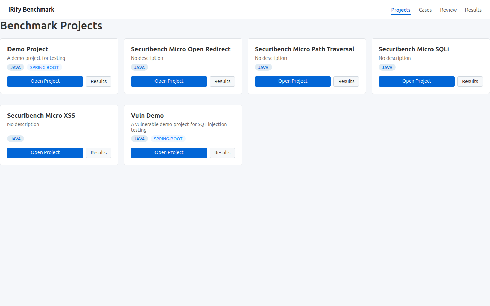
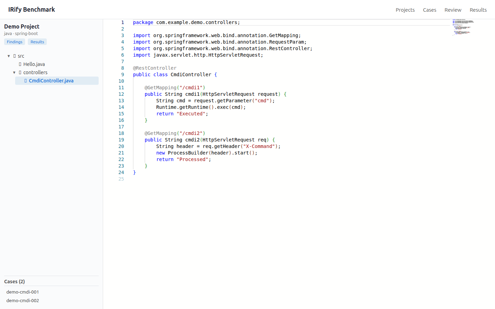
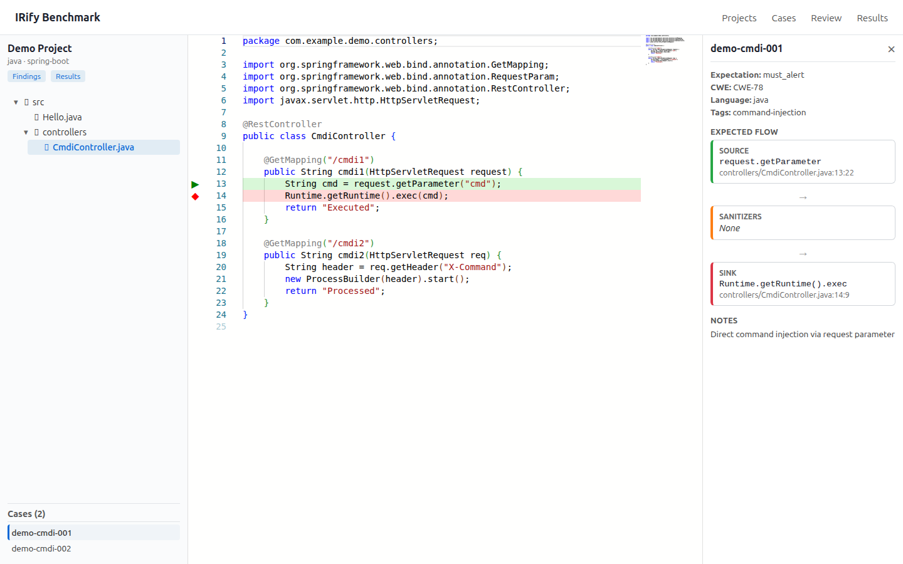

# IRify Benchmark

<p align="center">
  <b>A lightweight framework for evaluating code-scanning engines.</b><br>
  Maintain ground-truth annotations, run scans, match findings with full data-flow awareness, and generate comparison reports.
</p>

<p align="center">
  <a href="#-screenshots">Screenshots</a> •
  <a href="#-why-irify-benchmark">Why</a> •
  <a href="#-quick-start">Quick Start</a> •
  <a href="#-architecture">Architecture</a> •
  <a href="#-cli-usage">CLI</a>
</p>

---

## 📸 Screenshots

### Project Dashboard
Browse all benchmark projects, languages, and frameworks at a glance.

<p align="center">
  
</p>

### IDE-Style Audit Explorer
Navigate source files with a project tree and inspect code in the Monaco Editor—just like your IDE.

<p align="center">
  
</p>

### Flow-Aware Case Detail
Visualize the complete expected data flow: **Source → Sanitizers → Sink**. The editor highlights exact lines so you can verify whether the engine truly traced the taint path.

<p align="center">
  
</p>

---

## ✨ Why IRify Benchmark?

### AI-Native & CLI-First

Every operation—project import, scan execution, result matching, and report generation—can be driven from the **command line** without touching a GUI. This makes the framework ideal for:

- **AI Agents** automating benchmark regression tests
- **CI/CD pipelines** running nightly engine evaluations
- **Reproducible research** with version-controlled ground truth

### Source → Sanitizer → Sink Flow Matching

Traditional benchmarks often annotate only the **Sink** (e.g., the line where `executeQuery` is called). This is problematic because:

- A hit on the Sink line does **not** prove the engine traced the taint from entry to exit.
- **Sanitizers** (validation / encoding logic) are ignored, causing safe code to be misclassified as a miss.

IRify Benchmark uses **Flow** as the atomic unit of truth. Each case can declare:

| Element | Description | Example |
|---------|-------------|---------|
| **Source** | Where user-controlled input enters the program | `request.getParameter("name")` |
| **Sanitizer** | Where taint is neutralized into safe data | `ESAPI.encoder().encodeForHTML(...)` |
| **Sink** | Where the actual security risk is triggered | `stmt.executeQuery(sql)` |

When matching engine findings against ground truth, the framework validates the **entire data-flow path**, not just the Sink coordinate. This means:

- **True taint-tracking capability** is measured, not just "did it guess the right line number?"
- **Sanitizer-aware scoring** prevents penalizing engines that correctly recognize safe code.
- Evaluation results are **actionable** for guiding engine development.

---

## 🚀 Quick Start

```bash
# Build the backend + frontend
make all

# Start the development stack (frontend dev server + backend API)
make dev

# Run tests
go test ./...
make e2e

# Or start the production server directly
make serve   # backend on :8080, serves web/dist SPA
```

For detailed CLI commands see [`docs/cli-usage.md`](docs/cli-usage.md).

---

## 🏗️ Architecture

```
irify-benchmark/
├── cmd/irify-benchmark/     # CLI entrypoint + HTTP server (REST API + SPA fallback)
├── internal/
│   ├── store/               # Hybrid storage: FS (Git-tracked) + SQLite (runtime)
│   ├── project/             # Project CRUD & file-tree operations
│   ├── cases/               # Ground-truth case management
│   ├── matcher/             # FlowMatcher: full-path finding ↔ case matching engine
│   ├── pipeline/            # Evaluation pipeline: scan → match → result
│   ├── runner/              # Engine runners (external CLI / mock)
│   ├── reporter/            # Report generators (JSON / Markdown / HTML)
│   └── reviewer/            # Pending-review workflow (approve / reject)
├── pkg/
│   ├── schema/              # Core data models (Project, Case, Finding, Result, ...)
│   └── engine/              # Engine interface definition
├── web/                     # React 19 + Vite + Monaco Editor frontend
├── cases/                   # Project source & ground-truth YAML (Git-tracked)
└── data/                    # SQLite runtime database (not in Git)
```

### Storage Model: Dual-Track

| Data | Storage | Git? | Notes |
|------|---------|------|-------|
| `cases/{id}/src/` | File System | **Yes** | Human-curated source, must be diffable |
| `cases/{id}/cases.yaml` | File System | **Yes** | Ground-truth annotations, reviewed in PRs |
| Findings | SQLite | No | Machine-generated, partitioned by (project, engine, version) |
| Results | SQLite | No | Reproducible evaluation output |
| Pending Review | SQLite | No | Runtime workflow state |

---

## ⚙️ Evaluation Pipeline

```
┌─────────┐    ┌────────┐    ┌──────────┐    ┌─────────┐
│ Project │───→│ Runner │───→│ Matcher  │───→│ Reporter│
│  + Case │    │ (Scan) │    │ (Match)  │    │ (Report)│
└─────────┘    └────────┘    └──────────┘    └─────────┘
```

1. **Runner** invokes the external engine CLI and stores raw findings in SQLite.
2. **Matcher** compares each finding against annotated cases using **Source-Sanitizer-Sink flow matching**.
3. **Reporter** outputs JSON, Markdown, or HTML reports with precision / recall / F1 metrics.

---

## 📊 Supported Benchmarks

### OWASP Benchmark
- Run against the official `BenchmarkJava` suite.
- Generates standard `TP / FN / FP / TN / TPR / FPR / Score` metrics.
- Scoring follows the OWASP formula: `Score = (TPR − FPR) × 100`.

### Custom Project Suites
- Import any Git repository as a benchmark project.
- Annotate cases via YAML or the web UI.
- Re-run evaluations automatically when the engine or annotations change.

---

## 🛠️ Development

```bash
# Backend only
make build

# Frontend only
cd web && npm install && npm run dev

# Build frontend for production
cd web && npm run build

```

### Tech Stack

| Layer | Technology |
|-------|------------|
| CLI / Backend | Go 1.22, cobra, sqlite3 (CGO), yaml.v3 |
| Frontend | React 19, TypeScript, Vite, Monaco Editor |
| Build | make, npm |
| Testing | go test, bash e2e |

---

## 📜 License

This project is licensed under the [MIT License](LICENSE).
