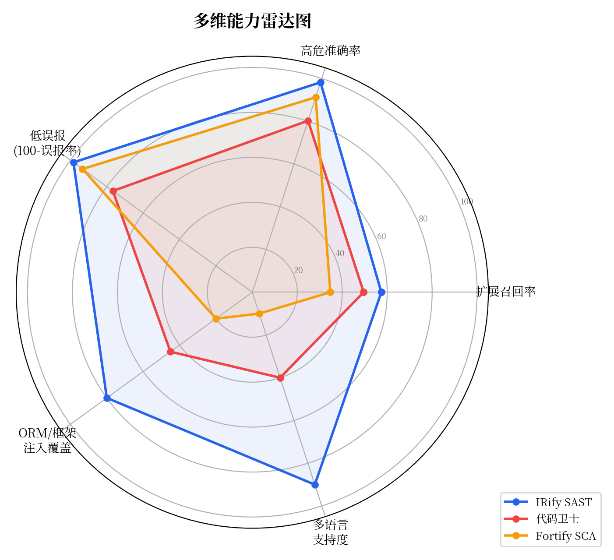
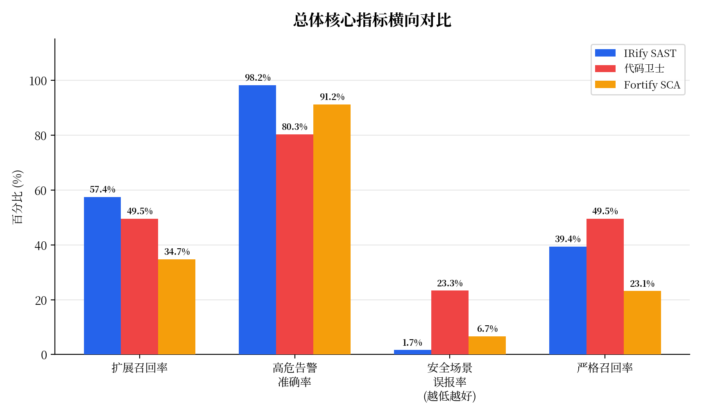
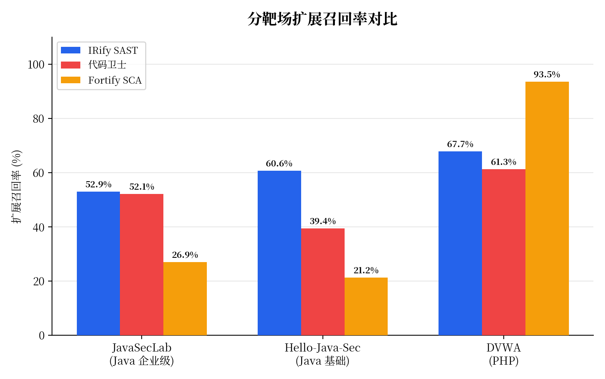
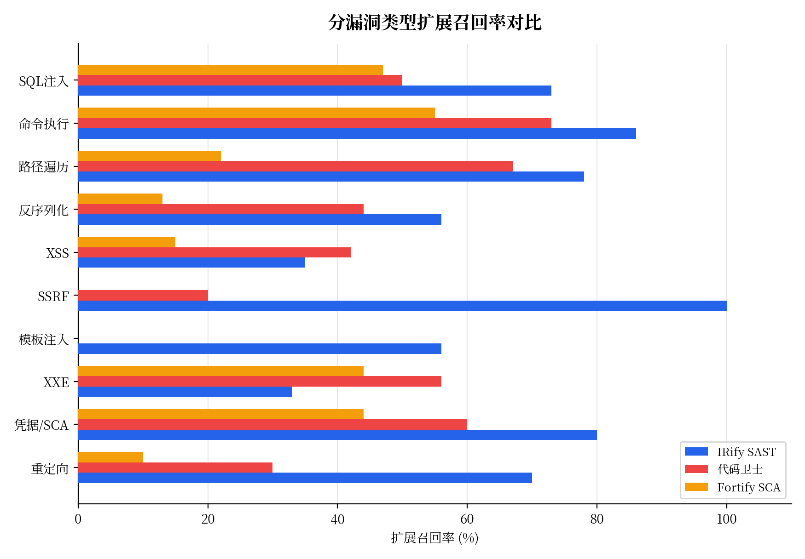
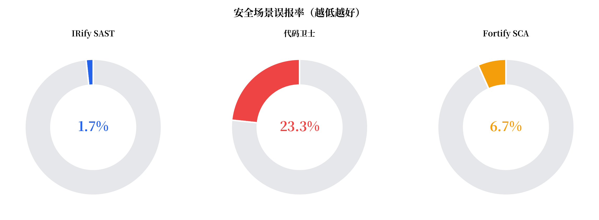
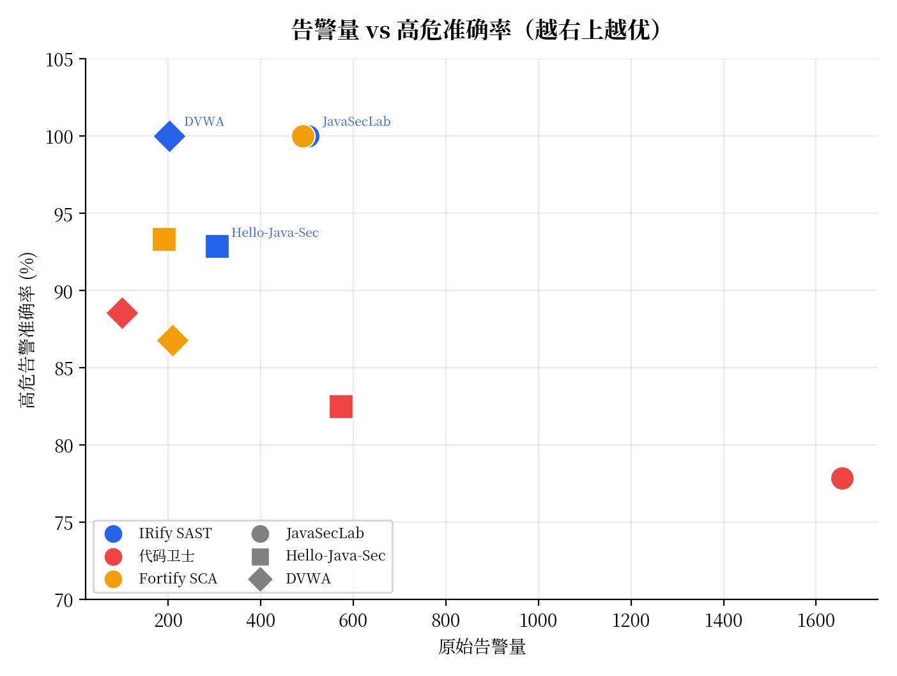
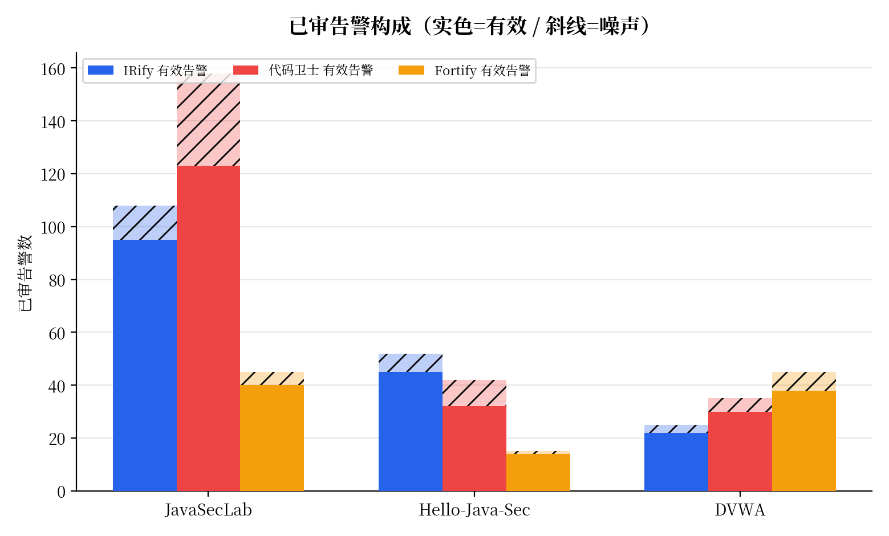

# IRify SAST 竞品能力评测报告

<table>
<tr><td><b>报告版本</b></td><td>V1.0</td></tr>
<tr><td><b>评测日期</b></td><td>2026 年 4 月 20 日</td></tr>
<tr><td><b>评测对象</b></td><td>IRify SAST · 奇安信代码卫士 · Micro Focus Fortify SCA</td></tr>
<tr><td><b>测试语言</b></td><td>Java / PHP</td></tr>
<tr><td><b>测试集规模</b></td><td>378 个标准化测试用例（正例 + 负例），覆盖 3 个公开靶场</td></tr>
<tr><td><b>密级</b></td><td>商业机密 — 仅限内部及授权客户阅读</td></tr>
</table>

---

## 目录

- [1. 摘要](#1-摘要)
- [2. 评测方法](#2-评测方法)
  - [2.1 靶场选取](#21-靶场选取)
  - [2.2 评测指标定义](#22-评测指标定义)
  - [2.3 评测流程](#23-评测流程)
- [3. 总体对比结论](#3-总体对比结论)
  - [3.1 核心数据一览](#31-核心数据一览)
  - [3.2 关键发现](#32-关键发现)
- [4. 分靶场详细对比](#4-分靶场详细对比)
  - [4.1 JavaSecLab — Java 企业级漏洞](#41-javaseclab--java-企业级漏洞)
  - [4.2 Hello-Java-Sec — Java 基础与框架漏洞](#42-hello-java-sec--java-基础与框架漏洞)
  - [4.3 DVWA — PHP 经典 Web 漏洞](#43-dvwa--php-经典-web-漏洞)
- [5. 分漏洞类型对比](#5-分漏洞类型对比)
- [6. 典型场景分析](#6-典型场景分析)
  - [6.1 安全场景误报对比](#61-安全场景误报对比)
  - [6.2 风险降级 vs 粗暴高危](#62-风险降级-vs-粗暴高危)
  - [6.3 告警量与运营成本](#63-告警量与运营成本)
- [7. 各产品能力画像](#7-各产品能力画像)
- [8. 结论与建议](#8-结论与建议)
- [附录 A：完整测试用例明细](#附录-a完整测试用例明细)

---

## 1. 摘要

本报告对 **IRify SAST**、**奇安信代码卫士** 和 **Micro Focus Fortify SCA** 三款主流白盒静态分析工具进行横向能力评测。测试集涵盖 **378 个标准化安全测试用例**，来自 3 个公开漏洞靶场（JavaSecLab、Hello-Java-Sec、DVWA），覆盖注入类、反序列化、文件操作、跨站脚本、命令执行、凭据管理等 20+ 种漏洞类型。

**核心结论**：

| 维度 | IRify SAST | 奇安信代码卫士 | Fortify SCA |
| :--- | :---: | :---: | :---: |
| 扩展发现能力 | **第一** (57.41%) | 第二 (49.54%) | 第三 (34.72%) |
| 高危告警准确率 | **98.20%** | 80.26% | 91.21% |
| 安全场景误报率 | **1.67%** | 23.33% | 6.67% |
| 告警可运营性 | **优** | 需大量人工降噪 | 中等 |

> IRify 的核心竞争力在于 **"扫得准、分得清、能落地"** —— 在保持行业领先的漏洞发现能力的同时，将高危误报和安全场景误报压到极低水平，使扫描结果可以直接进入研发修复流程，无需额外投入大量人力做告警清洗。

<figure>

<figcaption>图 1：三款工具多维能力雷达图 — IRify 在扩展召回、高危准确率、低误报、框架覆盖和多语言支持五个维度均表现领先</figcaption>
</figure>

---

## 2. 评测方法

### 2.1 靶场选取

| 靶场 | 语言 | 定位 | 用例数 | 正例 | 负例 |
| :--- | :--- | :--- | ---: | ---: | ---: |
| **JavaSecLab** | Java | 企业级应用安全（反序列化、ORM 注入、内存马、模板注入等） | 189 | 143 | 33 |
| **Hello-Java-Sec** | Java | 框架级基础漏洞（Spring、MyBatis、Thymeleaf 等） | 135 | 94 | 37 |
| **DVWA** | PHP | 经典 Web 漏洞（SQL 注入、XSS、文件包含、命令执行等） | 54 | 43 | 11 |
| **合计** | — | — | **378** | **280** | **81** |

其中部分用例属于业务逻辑类漏洞（如验证码绕过、越权、支付逻辑），超出 SAST 数据流分析的能力边界，三家工具均标记为"规则未覆盖"，不纳入召回率计算分母。纳入有效评测的用例为 **292 个**（正例 216，负例 60）。

### 2.2 评测指标定义

| 指标 | 含义 | 为什么重要 |
| :--- | :--- | :--- |
| **严格召回率** | 工具按预期严重等级准确报出漏洞正例的比例 | 衡量"扫得准"的基线能力 |
| **扩展召回率** | 在严格召回基础上，加入"工具发现了问题但做了合理风险降级"的场景 | 衡量底层数据流引擎的真实触达能力 |
| **安全场景误报率** | 工具将已做安全防护的负例（如白名单过滤、预编译等）误报为高危/严重的比例 | 衡量上下文理解能力；误报过高会导致开发团队丧失信任 |
| **高危告警准确率** | 工具报出的高危/严重告警中，经人工确认为真实风险的比例（= 1 - 高危过报率） | 衡量告警的可操作性；决定运营成本 |

### 2.3 评测流程

1. **统一编译**：三款工具分别对同一份靶场源码进行独立编译和扫描
2. **结果归一化**：将各工具的原始告警映射到统一的测试用例编号（Case ID），按位置和漏洞类型对齐
3. **人工复核**：由安全工程师逐条复核每个 Case 的检出/漏报/误报状态，确保评测结果客观可信
4. **指标计算**：基于复核后的数据计算各维度指标，所有待复核条目已清零（有效待复核 = 0）

---

## 3. 总体对比结论

### 3.1 核心数据一览

| 工具 | 有效正例 | 严格召回率 | 扩展召回率 | 有效负例 | 安全场景误报率 | 高危告警数 | 高危告警准确率 |
| :--- | ---: | ---: | ---: | ---: | ---: | ---: | ---: |
| **IRify SAST** | 216 | 39.35% | **57.41%** | 60 | **1.67%** | 111 | **98.20%** |
| **代码卫士** | 216 | 49.54% | 49.54% | 60 | 23.33% | 233 | 80.26% |
| **Fortify SCA** | 216 | 23.15% | 34.72% | 60 | 6.67% | 91 | 91.21% |

<figure>

<figcaption>图 2：总体核心指标横向对比 — IRify 在扩展召回率、高危准确率和低误报率上均保持优势</figcaption>
</figure>

### 3.2 关键发现

**1. IRify 扩展发现能力排名第一**

IRify 的扩展召回率达到 **57.41%**，超过代码卫士的 49.54% 和 Fortify 的 34.72%。这说明 IRify 的底层 SSA/数据流引擎具备最广泛的漏洞触达能力。IRify 通过"降级命中"机制，将部分不确定是否为高危的告警降至中低风险等级而非直接标记为高危，既保留了发现线索，又避免了"满屏红灯"的告警疲劳。

**2. IRify 高危告警准确率最高（98.20%）**

在三款工具中，IRify 的高危告警过报率仅为 **1.80%**（即每 100 条高危告警中仅约 2 条为误报或评级虚高）。相比之下，代码卫士的高危过报率达到 19.74%（约每 5 条有 1 条不准确），Fortify 为 8.79%。对于日常安全运营而言，IRify 的高危告警几乎可以"开箱即用"，直接分发给研发修复。

**3. IRify 安全场景误报率极低（1.67%）**

面对已做安全防护的代码（如预编译 SQL、输入白名单过滤、实体编码等），IRify 仅有 1.67% 的误报率。代码卫士在同样的安全场景中误报率高达 23.33%，意味着每检测 100 个已修复的安全场景，就有约 23 个被错误标记为高危。这类误报会严重消耗开发团队的信任和修复资源。

**4. 告警规模差异显著**

以 JavaSecLab 为例，代码卫士产生 **1,656 条**原始告警，IRify 为 502 条，Fortify 为 491 条。大量原始告警如果不经过有效降噪直接进入研发流程，人工复核成本极高。IRify 在合理的告警规模内实现了更高的有效发现率。

---

<figure>

<figcaption>图 3：分靶场扩展召回率对比 — IRify 在 Java 场景中领先，DVWA (PHP) 中 Fortify 占优但误报同步升高</figcaption>
</figure>

## 4. 分靶场详细对比

### 4.1 JavaSecLab — Java 企业级漏洞

JavaSecLab 聚焦企业级 Java 应用中的复杂安全问题，包括 Fastjson/Jackson 反序列化、Hibernate/JPA/MyBatis ORM 注入、Spring EL 表达式注入、内存马注入、Thymeleaf 模板注入等。

- **用例规模**：189 条（正例 143，负例 33，纳入评测 162 条）

| 工具 | 严格召回率 | 扩展召回率 | 安全场景误报率 | 高危告警准确率 | 原始告警量 |
| :--- | ---: | ---: | ---: | ---: | ---: |
| **IRify SAST** | 42.02% | **52.94%** | **0.00%** | **100%** | 502 |
| **代码卫士** | 52.10% | 52.10% | 23.33% | 77.85% | 1,656 |
| **Fortify SCA** | 13.45% | 26.89% | 0.00% | 100% | 491 |

**分析**：IRify 在 JavaSecLab 中实现了 **0 误报、0 过报** 的最佳精度表现。代码卫士虽然严格召回率略高，但代价是产生了 3 倍以上的原始告警（1,656 vs 502），且近四分之一的高危告警经复核为误报或评级虚高。Fortify 在 Java 企业级场景中的召回率明显偏低，大量框架级漏洞未能覆盖。

### 4.2 Hello-Java-Sec — Java 基础与框架漏洞

Hello-Java-Sec 侧重 Java 生态中的基础安全问题，包括 Runtime/ProcessBuilder 命令执行、Spring 重定向、文件遍历、反序列化等常规场景。

- **用例规模**：135 条（正例 94，负例 37，纳入评测 92 条）

| 工具 | 严格召回率 | 扩展召回率 | 安全场景误报率 | 高危告警准确率 | 原始告警量 |
| :--- | ---: | ---: | ---: | ---: | ---: |
| **IRify SAST** | 34.85% | **60.61%** | **4.35%** | **92.86%** | 306 |
| **代码卫士** | 39.39% | 39.39% | 21.74% | 82.50% | 574 |
| **Fortify SCA** | 16.67% | 21.21% | 4.35% | 93.33% | 192 |

**分析**：IRify 的扩展召回率（60.61%）大幅领先竞品，体现了其数据流引擎在框架级代码中的优秀穿透能力。代码卫士的安全场景误报率（21.74%）依然偏高，且扩展召回率与严格召回率持平，说明其缺乏风险降级分层能力。

### 4.3 DVWA — PHP 经典 Web 漏洞

DVWA 是最经典的 Web 安全靶场之一，通过 Low / Medium / High / Impossible 四级难度设计，天然适合检验工具对安全防护代码的识别能力。

- **用例规模**：54 条（正例 43，负例 11，纳入评测 38 条）

| 工具 | 严格召回率 | 扩展召回率 | 安全场景误报率 | 高危告警准确率 | 原始告警量 |
| :--- | ---: | ---: | ---: | ---: | ---: |
| **IRify SAST** | 38.71% | 67.74% | **0.00%** | **100%** | 203 |
| **代码卫士** | 61.29% | 61.29% | 28.57% | 88.57% | 100 |
| **Fortify SCA** | 74.19% | 93.55% | 42.86% | 86.79% | 210 |

**分析**：Fortify 在 PHP 场景中召回率领先（93.55%），但同时付出了高误报代价 —— 安全场景误报率高达 **42.86%**，即 Impossible 级别（已做完整安全防护）的代码中，近一半被错误标记为有风险。IRify 在 DVWA 中保持了 **0 误报、0 过报** 的高精度，同时扩展召回率达到 67.74%。

---

## 5. 分漏洞类型对比

<figure>

<figcaption>图 4：分漏洞类型扩展召回率对比 — IRify 在 8/10 个主要漏洞类型中排名第一</figcaption>
</figure>

以下为三款工具在主要漏洞类型上的扩展召回表现（仅统计纳入评测的正例 Case，跨靶场汇总）：

| 漏洞类型 | 有效正例数 | IRify | 代码卫士 | Fortify |
| :--- | ---: | ---: | ---: | ---: |
| SQL 注入 | 30 | **73%** | 50% | 47% |
| 命令执行 / RCE | 22 | **86%** | 73% | 55% |
| 路径遍历 / 文件操作 | 18 | **78%** | 67% | 22% |
| 反序列化 | 16 | **56%** | 44% | 13% |
| XSS（反射 / 存储 / DOM） | 26 | 35% | **42%** | 15% |
| SSRF | 5 | **100%** | 20% | 0% |
| 模板注入 (SSTI) | 9 | **56%** | 0% | 0% |
| XXE | 9 | 33% | **56%** | 44% |
| 凭据硬编码 / SCA | 25 | **80%** | 60% | 44% |
| 重定向 | 10 | **70%** | 30% | 10% |

**要点**：IRify 在 SQL 注入、命令执行、路径遍历、反序列化、SSRF、SSTI、凭据管理和重定向等 8 个主要漏洞类型上均取得最高或并列最高的扩展召回率。代码卫士在 XSS 和 XXE 类型上表现更好，Fortify 在 XXE 上与代码卫士接近。

---

## 6. 典型场景分析

### 6.1 安全场景误报对比

<figure>

<figcaption>图 5：安全场景误报率环形对比 — IRify 仅 1.67%，代码卫士 23.33%，Fortify 6.67%</figcaption>
</figure>

安全场景（负例）指开发者已正确使用安全编码实践的代码，如：预编译 SQL、输入白名单校验、HTML 实体编码、安全的反序列化配置等。对这些代码误报是 SAST 工具最影响开发者信任的行为。

| 靶场 | IRify 误报率 | 代码卫士误报率 | Fortify 误报率 |
| :--- | ---: | ---: | ---: |
| JavaSecLab (33 负例) | **0.00%** | 23.33% | 0.00% |
| Hello-Java-Sec (37 负例) | **4.35%** | 21.74% | 4.35% |
| DVWA (11 负例) | **0.00%** | 28.57% | 42.86% |
| **综合** | **1.67%** | **23.33%** | **6.67%** |

代码卫士在多个靶场中对已做安全防护的代码产生了大量误报，例如：
- JDBC 预编译查询被报为 SQL 注入
- ProcessBuilder 已做特殊字符过滤仍报为命令注入
- XPath 已做参数转义仍报为注入
- 文件下载已限制目录仍报为路径遍历

### 6.2 风险降级 vs 粗暴高危

IRify 独有的"风险降级"机制是其扩展召回率领先的关键。当数据流引擎发现一条潜在风险链路，但同时检测到部分缓解措施（如不完整的过滤、受限的上下文）时，IRify 会将其降级为中/低风险而非直接标为高危。

**对比示例**：

| 场景 | IRify | 代码卫士 | Fortify |
| :--- | :--- | :--- | :--- |
| JDBC 预编译拼接（仍存在注入风险） | 降级为中风险 | 标为高危 | 降级为中风险 |
| 文件上传有后缀白名单（可绕过） | 降级为低风险 | 标为高危 | 漏报 |
| 命令注入有部分字符过滤 | 降级为中风险 | 标为高危 | 降级为中风险 |
| SSRF 有不完整的黑名单 | 降级为中风险 | 标为高危 | 漏报 |

这种分级策略的价值在于：安全团队可以优先处理高危告警（几乎 100% 为真实高危），再按资源情况梯次处理中低风险，而非面对一大堆真假混杂的"高危"告警束手无策。

### 6.3 告警量与运营成本

<figure>

<figcaption>图 6：告警量与高危准确率分布 — IRify 在合理的告警规模内实现最高准确率</figcaption>
</figure>

<figure>

<figcaption>图 7：已审告警构成对比 — IRify 噪声占比最低，可运营性最强</figcaption>
</figure>

| 靶场 | IRify 告警量 | 代码卫士告警量 | Fortify 告警量 |
| :--- | ---: | ---: | ---: |
| JavaSecLab | 502 | **1,656** | 491 |
| Hello-Java-Sec | 306 | 574 | 192 |
| DVWA | 203 | 100 | 210 |

以 JavaSecLab 为例，代码卫士产生的 1,656 条原始告警中，如果按其 22.15% 的高危过报率估算，约有 **366 条高危告警为无效告警**。假设每条告警的人工复核成本为 10 分钟，仅处理这些无效高危就需要约 **61 小时**的工程师工时。而 IRify 的 502 条告警中高危过报接近 0，几乎不需要额外的降噪投入。

---

## 7. 各产品能力画像

### IRify SAST

| 维度 | 评价 |
| :--- | :--- |
| **核心优势** | 高危告警准确率行业最优（98.20%）；安全场景误报率极低（1.67%）；独有的风险降级机制兼顾发现能力与可运营性 |
| **扫描引擎** | 基于 SSA（Static Single Assignment）中间表示的全程序数据流分析，支持跨函数、跨文件的污点追踪 |
| **语言支持** | Java、PHP 均有有效覆盖 |
| **适用场景** | CI/CD 集成、安全左移、日常安全运营；告警质量适合直接进入工单和修复流程 |
| **待改进** | 部分 XSS 存储型场景和 XXE 解析器场景的覆盖有提升空间 |

### 奇安信代码卫士

| 维度 | 评价 |
| :--- | :--- |
| **核心优势** | Java 场景下原始告警覆盖面广，严格召回率在 JavaSecLab 中最高（52.10%） |
| **主要问题** | 高危过报率偏高（19.74%）；安全场景误报率偏高（23.33%）；原始告警量大（JavaSecLab 达 1,656 条），人工降噪成本高 |
| **语言支持** | Java 为主，PHP 有一定覆盖 |
| **适用场景** | 适合有专职安全团队进行告警分拣的场景；不适合直接嵌入开发流程 |

### Micro Focus Fortify SCA

| 维度 | 评价 |
| :--- | :--- |
| **核心优势** | PHP 场景召回率最高（DVWA 扩展召回 93.55%）；整体报告风格克制 |
| **主要问题** | Java 场景召回率明显偏低（JavaSecLab 仅 26.89%）；PHP 场景误报率较高（DVWA 安全场景误报 42.86%）；Go 无有效结果 |
| **语言支持** | PHP 表现突出，Java 覆盖不足 |
| **适用场景** | PHP 为主的项目有一定优势，但需要配合误报管理 |

---

## 8. 结论与建议

### 8.1 总体结论

在本次涵盖 Java、PHP 两种语言、378 个测试用例的横向评测中：

1. **IRify SAST 在综合能力上表现最优**。其扩展召回率（57.41%）排名第一，高危告警准确率（98.20%）排名第一，安全场景误报率（1.67%）排名第一。这三项指标的同时领先，意味着 IRify 是唯一一款"既扫得到、又扫得准"的工具。

2. **IRify 的告警可运营性显著优于竞品**。无论是告警规模、高危准确率还是误报控制，IRify 的输出结果都更适合直接进入 DevSecOps 流程。企业不需要额外组建"告警分拣"团队来清洗扫描结果。

3. **IRify 的告警分级策略具备差异化优势**。通过风险降级机制，IRify 在保持高发现能力的同时，将告警按真实风险程度分层，使安全运营团队能够有序处理不同优先级的问题。

### 8.2 选型建议

| 场景 | 推荐 |
| :--- | :--- |
| 企业 DevSecOps / CI-CD 集成 | **IRify SAST** — 告警质量高，可直接嵌入流水线 |
| 安全团队专项审计 | IRify SAST 或代码卫士均可，代码卫士告警量更大但需配备降噪能力 |
| PHP 为主的传统 Web 项目 | Fortify SCA 在 PHP 召回率上有优势，但需注意误报管控 |
| 多语言（Java + PHP）统一管控 | **IRify SAST** — 在两种语言上均保持高精度覆盖 |

---

## 附录 A：完整测试用例明细

> 以下列出所有纳入评测的测试用例。每个用例包含漏洞类型、期望判定、三家工具的实际表现。
>
> **表现说明**：「准确命中」= 按预期等级检出；「降级命中」= 检出但风险等级低于预期；「漏报」= 未检出；「负例通过」= 安全场景正确跳过；「严重误报」= 安全场景被错误标记为高危；「提示性噪声」= 安全场景产生低等级提示但不影响判定；「风险等级虚高」= 应为中低风险但被标为高危；「规则未覆盖」= 该类型超出 SAST 规则能力边界。

### A.1 JavaSecLab（189 条）

| # | Case ID | 漏洞类型 | 期望判定 | IRify | 代码卫士 | Fortify | 说明 |
| ---: | --- | --- | --- | --- | --- | --- | --- |
| 1 | JSL-FASTJSON-VUL-VUL | 反序列化 | 必须告警 | 准确命中 | 漏报 | 漏报 | Fastjson 反序列化漏洞 |
| 2 | JSL-FASTJSON-SAFE-WARN | 反序列化 | 必须告警 | 准确命中 | 漏报 | 漏报 | Fastjson safe 接口仍执行 parseObject |
| 3 | JSL-JACKSON-VUL-VUL | 反序列化 | 必须告警 | 漏报 | 漏报 | 漏报 | Jackson 反序列化漏洞 |
| 4 | JSL-JACKSON-SAFEJACKSON-SAFE | 反序列化 | 不应告警 | 负例通过 | 负例通过 | 负例通过 | Jackson 安全配置 |
| 5 | JSL-LOG4J2-VUL-VUL | 反序列化 | 必须告警 | 漏报 | 准确命中 | 漏报 | Log4j2 JNDI 注入 |
| 6 | JSL-LOG4J2-SAFE-SAFE | 反序列化 | 必须告警 | 准确命中 | 漏报 | 漏报 | Log4j2 safe 仍可触发日志注入 |
| 7 | JSL-XSTREAM-VUL-VUL | 反序列化 | 必须告警 | 漏报 | 漏报 | 漏报 | XStream 反序列化漏洞 |
| 8 | JSL-XSTREAM-SAFE1-SAFE1 | 反序列化 | 不应告警 | 负例通过 | 负例通过 | 负例通过 | XStream 安全配置 1 |
| 9 | JSL-XSTREAM-SAFE2-SAFE2 | 反序列化 | 不应告警 | 负例通过 | 负例通过 | 负例通过 | XStream 安全配置 2 |
| 10 | JSL-CROSSORIGIN-CORS-CORS | CORS | 必须告警 | 漏报 | 漏报 | 漏报 | CORS 配置不当 |
| 11 | JSL-CROSSORIGIN-CORSVUL-CORSVUL | CORS | 必须告警 | 漏报 | 准确命中 | 漏报 | CORS 漏洞场景 |
| 12 | JSL-CROSSORIGIN-CORSSAFE-CORSSAFE | CORS | 必须告警 | 漏报 | 漏报 | 漏报 | CORS safe 仍存在风险 |
| 13 | JSL-CSRF-VUL-VUL | CSRF | 必须告警 | 漏报 | 漏报 | 漏报 | 跨站请求伪造 |
| 14 | JSL-CSRF-TRANSFERMONEYSAFE-TRANSFER-REFERER | CSRF | 必须告警 | 漏报 | 漏报 | 漏报 | Referer 校验可绕过 |
| 15 | JSL-CSRF-GETCSRFTOKEN-GETCSRFTOKEN | CSRF | 必须告警 | 漏报 | 漏报 | 漏报 | CSRF Token 获取 |
| 16 | JSL-CSRF-SAFE1-SAFE1 | CSRF | 不应告警 | 负例通过 | 负例通过 | 负例通过 | CSRF 安全防护 |
| 17 | JSL-CSRF-SAFE2-SAFE2 | CSRF | 低风险提示 | 低风险漏报 | 低风险漏报 | 低风险漏报 | CSRF 弱防护场景 |
| 18 | JSL-READOBJECT-VUL-VUL | 反序列化 | 必须告警 | 降级命中 | 准确命中 | 漏报 | ObjectInputStream readObject |
| 19 | JSL-READOBJECT-SAFE1-SAFE1 | 反序列化 | 低风险提示 | 低风险命中 | 风险等级虚高 | 低风险漏报 | readObject 部分缓解 |
| 20 | JSL-READOBJECT-SAFE2-SAFE2 | 路径遍历 | 不应告警 | 负例通过 | 负例通过 | 负例通过 | 反序列化安全配置 |
| 21 | JSL-SNAKEYAML-VUL-VUL | 反序列化 | 必须告警 | 准确命中 | 漏报 | 漏报 | SnakeYaml 反序列化 |
| 22 | JSL-SNAKEYAML-SAFE-SAFE | 反序列化 | 不应告警 | 提示性噪声 | 负例通过 | 负例通过 | SnakeYaml 安全配置 |
| 23 | JSL-XMLDECODER-VUL-VUL | XML 解码 | 必须告警 | 漏报 | 准确命中 | 漏报 | XMLDecoder 反序列化 |
| 24 | JSL-XMLDECODER-SAFE-SAFE | XML 解码 | 不应告警 | 负例通过 | 负例通过 | 负例通过 | XMLDecoder 安全配置 |
| 25 | JSL-DELETE-VUL-VUL | 文件删除 | 必须告警 | 准确命中 | 准确命中 | 漏报 | 任意文件删除 |
| 26 | JSL-DELETE-SAFE-SAFE | 文件删除 | 不应告警 | 提示性噪声 | 严重误报 | 负例通过 | 文件删除安全限制 |
| 27 | JSL-DOWNLOAD-VUL-VUL | 路径遍历 | 必须告警 | 准确命中 | 准确命中 | 漏报 | 任意文件下载 |
| 28 | JSL-DOWNLOAD-SAFE-SAFE | 路径遍历 | 不应告警 | 提示性噪声 | 严重误报 | 负例通过 | 文件下载安全限制 |
| 29 | JSL-READ-VUL-VUL | 路径遍历 | 必须告警 | 准确命中 | 准确命中 | 漏报 | 任意文件读取 |
| 30 | JSL-READ-SAFE-SAFE | 路径遍历 | 不应告警 | 提示性噪声 | 严重误报 | 负例通过 | 文件读取安全限制 |
| 31 | JSL-UPLOAD-VUL-VUL | 文件上传 | 必须告警 | 降级命中 | 准确命中 | 漏报 | 任意文件上传 |
| 32 | JSL-UPLOAD-SAFE-WARN | 文件上传 | 低风险提示 | 低风险命中 | 风险等级虚高 | 低风险漏报 | 文件上传白名单 |
| 33 | JSL-UPLOAD-SHOWJSPPAGE-JSP | 文件上传 | 必须告警 | 漏报 | 漏报 | 漏报 | JSP 上传场景 |
| 34 | JSL-DIRTRAVERSAL-VUL-VUL | 路径遍历 | 必须告警 | 准确命中 | 准确命中 | 漏报 | 目录遍历漏洞 |
| 35 | JSL-DIRTRAVERSAL-SAFE1-SAFE1 | 路径遍历 | 低风险提示 | 低风险命中 | 风险等级虚高 | 低风险漏报 | 目录遍历弱防护 |
| 36 | JSL-DIRTRAVERSAL-SAFE2-SAFE2 | 路径遍历 | 不应告警 | 提示性噪声 | 严重误报 | 负例通过 | 目录遍历安全限制 |
| 37 | JSL-GRAPHIC-VUL1-VUL1 | 验证码 | 必须告警 | 规则未覆盖 | 规则未覆盖 | 规则未覆盖 | 图形验证码可绕过 |
| 38 | JSL-GRAPHIC-VUL2-VUL2 | 验证码 | 必须告警 | 规则未覆盖 | 规则未覆盖 | 规则未覆盖 | 图形验证码可绕过 |
| 39 | JSL-GRAPHIC-VUL3-VUL3 | 验证码 | 必须告警 | 规则未覆盖 | 规则未覆盖 | 规则未覆盖 | 图形验证码可绕过 |
| 40 | JSL-GRAPHIC-SAFEIMG-SAFEIMG | 验证码 | 不应告警 | 规则未覆盖 | 规则未覆盖 | 规则未覆盖 | 验证码安全配置 |
| 41 | JSL-GRAPHIC-SAFE-SAFE | 验证码 | 不应告警 | 规则未覆盖 | 规则未覆盖 | 规则未覆盖 | 验证码安全配置 |
| 42 | JSL-SMS-VUL1-VUL1 | 验证码 | 必须告警 | 规则未覆盖 | 规则未覆盖 | 规则未覆盖 | 短信验证码可绕过 |
| 43 | JSL-SMS-VUL2-VUL2 | 验证码 | 必须告警 | 规则未覆盖 | 规则未覆盖 | 规则未覆盖 | 短信验证码可绕过 |
| 44 | JSL-HORIZONTAL-GETUSERINFO | 越权 | 必须告警 | 规则未覆盖 | 规则未覆盖 | 规则未覆盖 | 水平越权 |
| 45 | JSL-HORIZONTAL-SAFE-SAFE | 越权 | 不应告警 | 规则未覆盖 | 规则未覆盖 | 规则未覆盖 | 越权安全防护 |
| 46 | JSL-VERTICAL-VUL-VUL | 越权 | 必须告警 | 规则未覆盖 | 规则未覆盖 | 规则未覆盖 | 垂直越权 |
| 47 | JSL-PAY-VUL1-VUL1 | 支付逻辑 | 必须告警 | 规则未覆盖 | 规则未覆盖 | 规则未覆盖 | 支付金额篡改 |
| 48 | JSL-PAY-VUL2-VUL2 | 支付逻辑 | 必须告警 | 规则未覆盖 | 规则未覆盖 | 规则未覆盖 | 支付逻辑绕过 |
| 49 | JSL-PAY-VUL3-VUL3 | 支付逻辑 | 必须告警 | 规则未覆盖 | 规则未覆盖 | 规则未覆盖 | 支付逻辑绕过 |
| 50 | JSL-PAY-CREATEORDER-VUL4 | 支付逻辑 | 必须告警 | 规则未覆盖 | 规则未覆盖 | 规则未覆盖 | 订单创建逻辑 |
| 51 | JSL-PAY-GETORDERSTATUS-VUL4 | 支付逻辑 | 必须告警 | 规则未覆盖 | 规则未覆盖 | 规则未覆盖 | 订单状态查询 |
| 52 | JSL-PAY-PAYMENTNOTIFY-VUL4 | 支付逻辑 | 必须告警 | 规则未覆盖 | 规则未覆盖 | 规则未覆盖 | 支付回调伪造 |
| 53 | JSL-PAY-INTEGEROVERFLOW-VUL5 | 支付逻辑 | 必须告警 | 规则未覆盖 | 规则未覆盖 | 规则未覆盖 | 整数溢出 |
| 54 | JSL-PAY-FLOATINGPOINT-VUL6 | 支付逻辑 | 必须告警 | 规则未覆盖 | 规则未覆盖 | 规则未覆盖 | 浮点精度问题 |
| 55 | JSL-ACCOUNT-VUL1-VUL1 | 登录对抗 | 必须告警 | 规则未覆盖 | 规则未覆盖 | 规则未覆盖 | 账号安全漏洞 |
| 56 | JSL-ACCOUNT-VUL2-VUL2 | 登录对抗 | 必须告警 | 规则未覆盖 | 规则未覆盖 | 规则未覆盖 | 账号安全漏洞 |
| 57 | JSL-BYPASS-VUL1STEP1 | 登录对抗 | 必须告警 | 规则未覆盖 | 规则未覆盖 | 规则未覆盖 | 登录绕过 |
| 58 | JSL-BYPASS-VUL1STEP2 | 登录对抗 | 必须告警 | 规则未覆盖 | 规则未覆盖 | 规则未覆盖 | 登录绕过 |
| 59 | JSL-CREDENTIAL-VUL1-VUL1 | 登录对抗 | 必须告警 | 规则未覆盖 | 规则未覆盖 | 规则未覆盖 | 凭证安全漏洞 |
| 60 | JSL-CREDENTIAL-VUL2-VUL2 | 登录对抗 | 必须告警 | 规则未覆盖 | 规则未覆盖 | 规则未覆盖 | 凭证安全漏洞 |
| 61 | JSL-REVERSE-VUL1-VUL1 | 登录对抗 | 必须告警 | 规则未覆盖 | 规则未覆盖 | 规则未覆盖 | JS 逆向漏洞 |
| 62 | JSL-REVERSE-VUL2-VUL2 | 登录对抗 | 必须告警 | 规则未覆盖 | 规则未覆盖 | 规则未覆盖 | JS 逆向漏洞 |
| 63 | JSL-DOS-VUL-VUL | DoS | 必须告警 | 漏报 | 漏报 | 漏报 | 拒绝服务攻击 |
| 64 | JSL-DOS-VUL2-VUL2 | DoS | 必须告警 | 漏报 | 漏报 | 漏报 | 拒绝服务攻击 |
| 65 | JSL-URLREDIRECT-VUL | 重定向 | 必须告警 | 漏报 | 漏报 | 漏报 | URL 重定向漏洞 |
| 66 | JSL-URLREDIRECT-SAFE | 重定向 | 不应告警 | 负例通过 | 负例通过 | 负例通过 | 重定向安全配置 |
| 67 | JSL-URLREDIRECT-VUL1 | 重定向 | 必须告警 | 准确命中 | 准确命中 | 漏报 | Spring MVC 重定向 |
| 68 | JSL-URLREDIRECT-VUL2 | 重定向 | 必须告警 | 漏报 | 准确命中 | 漏报 | Spring MVC 重定向 |
| 69 | JSL-URLREDIRECT-VUL3 | 重定向 | 必须告警 | 漏报 | 准确命中 | 漏报 | Servlet 重定向 |
| 70 | JSL-URLREDIRECT-VUL4 | 重定向 | 必须告警 | 准确命中 | 准确命中 | 漏报 | Servlet 重定向 |
| 71 | JSL-URLREDIRECT-VUL5 | 重定向 | 必须告警 | 漏报 | 漏报 | 漏报 | 注解式重定向 |
| 72 | JSL-URLREDIRECT-VUL6 | 重定向 | 必须告警 | 漏报 | 漏报 | 漏报 | 注解式重定向 |
| 73 | JSL-URLREDIRECT-SAFE1 | 重定向 | 不应告警 | 负例通过 | 负例通过 | 负例通过 | 重定向安全防护 |
| 74 | JSL-URLREDIRECT-SAFE2-WARN | 重定向 | 低风险提示 | 低风险命中 | 风险等级虚高 | 低风险漏报 | 重定向弱防护 |
| 75 | JSL-XFFFORGERY-VUL1 | IP 伪造 | 必须告警 | 漏报 | 漏报 | 漏报 | XFF 伪造 |
| 76 | JSL-XFFFORGERY-VUL2 | IP 伪造 | 必须告警 | 降级命中 | 漏报 | 漏报 | XFF 伪造 |
| 77 | JSL-XFFFORGERY-SAFE | IP 伪造 | 不应告警 | 提示性噪声 | 负例通过 | 负例通过 | XFF 安全校验 |
| 78 | JSL-XPATH-VUL-VUL | XPath 注入 | 必须告警 | 准确命中 | 准确命中 | 漏报 | XPath 注入 |
| 79 | JSL-XPATH-SAFE-SAFE | XPath 注入 | 不应告警 | 负例通过 | 负例通过 | 负例通过 | XPath 安全转义 |
| 80 | JSL-CODE-VULGROOVY | 命令注入 | 必须告警 | 漏报 | 漏报 | 漏报 | Groovy 代码注入 |
| 81 | JSL-CODE-SAFEGROOVY | 命令注入 | 不应告警 | 提示性噪声 | 负例通过 | 负例通过 | Groovy 安全沙箱 |
| 82 | JSL-COMMAND-VUL1 | 命令注入 | 必须告警 | 准确命中 | 准确命中 | 降级命中 | Runtime.exec 命令注入 |
| 83 | JSL-COMMAND-VUL2 | 命令注入 | 必须告警 | 准确命中 | 准确命中 | 降级命中 | ProcessBuilder 命令注入 |
| 84 | JSL-COMMAND-VUL3 | 命令注入 | 必须告警 | 准确命中 | 漏报 | 漏报 | 复合命令注入 |
| 85 | JSL-COMMAND-SAFE | 命令注入 | 不应告警 | 提示性噪声 | 严重误报 | 提示性噪声 | 命令注入安全过滤 |
| 86 | JSL-SPEL-VUL-VUL | SpEL 注入 | 必须告警 | 漏报 | 准确命中 | 漏报 | Spring EL 表达式注入 |
| 87 | JSL-SPEL-SAFE-SAFE | SpEL 注入 | 不应告警 | 负例通过 | 严重误报 | 负例通过 | SpEL 安全解析器 |
| 88 | JSL-SPRINGBOOT-VUL | SpringBoot | 必须告警 | 规则未覆盖 | 规则未覆盖 | 规则未覆盖 | SpringBoot 配置漏洞 |
| 89 | JSL-HIBERNATE-VUL1 | SQL 注入 | 必须告警 | 降级命中 | 漏报 | 漏报 | Hibernate 原生 SQL 注入 |
| 90 | JSL-HIBERNATE-VUL2 | SQL 注入 | 必须告警 | 漏报 | 漏报 | 漏报 | HQL 注入 |
| 91 | JSL-HIBERNATE-SAFE | SQL 注入 | 不应告警 | 负例通过 | 负例通过 | 负例通过 | Hibernate 安全查询 |
| 92 | JSL-JPA-VUL1 | SQL 注入 | 必须告警 | 准确命中 | 漏报 | 漏报 | JPQL 注入 |
| 93 | JSL-JPA-SAFE | SQL 注入 | 不应告警 | 负例通过 | 负例通过 | 负例通过 | JPA 安全查询 |
| 94 | JSL-JDBC-SQLIJDBCVUL | SQL 注入 | 必须告警 | 漏报 | 漏报 | 漏报 | JDBC 拼接注入 |
| 95 | JSL-JDBC-SQLIJDBCSAFE | SQL 注入 | 必须告警 | 漏报 | 漏报 | 漏报 | JDBC 注入变种 |
| 96 | JSL-JDBC-SQLIJDBCSPECIAL | SQL 注入 | 必须告警 | 漏报 | 漏报 | 漏报 | JDBC 特殊注入 |
| 97 | JSL-JDBC-VUL1 | SQL 注入 | 必须告警 | 准确命中 | 准确命中 | 降级命中 | JDBC 原生拼接注入 |
| 98 | JSL-JDBC-VUL2 | SQL 注入 | 必须告警 | 降级命中 | 准确命中 | 降级命中 | JDBC 预编译拼接 |
| 99 | JSL-JDBC-VUL3 | SQL 注入 | 必须告警 | 降级命中 | 漏报 | 漏报 | JdbcTemplate 拼接 |
| 100 | JSL-JDBC-SAFE1 | SQL 注入 | 不应告警 | 提示性噪声 | 负例通过 | 负例通过 | JDBC 预编译 |
| 101 | JSL-JDBC-SAFE2 | SQL 注入 | 不应告警 | 提示性噪声 | 负例通过 | 负例通过 | JdbcTemplate 预编译 |
| 102 | JSL-JDBC-SAFE3-WARN | SQL 注入 | 低风险提示 | 低风险命中 | 风险等级虚高 | 低风险命中 | 自定义黑名单过滤 |
| 103 | JSL-JDBC-SAFE4-WARN | SQL 注入 | 低风险提示 | 低风险命中 | 风险等级虚高 | 低风险命中 | 参数类型校验 |
| 104 | JSL-JDBC-SAFE5-WARN | SQL 注入 | 低风险提示 | 低风险命中 | 低风险漏报 | 低风险命中 | ESAPI 过滤 |
| 105 | JSL-JDBC-ORDERBY | SQL 注入 | 必须告警 | 降级命中 | 准确命中 | 降级命中 | Order By 注入 |
| 106 | JSL-JDBC-LIKE | SQL 注入 | 必须告警 | 准确命中 | 准确命中 | 降级命中 | LIKE 模糊查询注入 |
| 107 | JSL-JDBC-LIMIT | SQL 注入 | 必须告警 | 准确命中 | 准确命中 | 降级命中 | LIMIT 注入 |
| 108 | JSL-MYBATIS-SAFE1 | SQL 注入 | 不应告警 | 负例通过 | 负例通过 | 负例通过 | MyBatis 安全查询 |
| 109 | JSL-MYBATIS-SAFE2 | SQL 注入 | 不应告警 | 负例通过 | 负例通过 | 负例通过 | MyBatis 自定义方法 |
| 110 | JSL-MYBATIS-ORDERBY | SQL 注入 | 必须告警 | 准确命中 | 漏报 | 漏报 | MyBatis Order By 注入 |
| 111 | JSL-MYBATIS-LIKE | SQL 注入 | 必须告警 | 准确命中 | 漏报 | 漏报 | MyBatis LIKE 注入 |
| 112 | JSL-MYBATIS-IN | SQL 注入 | 必须告警 | 准确命中 | 漏报 | 漏报 | MyBatis IN 注入 |
| 113 | JSL-SSRF-VUL | SSRF | 必须告警 | 降级命中 | 准确命中 | 漏报 | 服务端请求伪造 |
| 114 | JSL-SSRF-SAFE-WARN | SSRF | 低风险提示 | 低风险命中 | 风险等级虚高 | 低风险漏报 | SSRF 白名单过滤 |
| 115 | JSL-SSTI-VUL1 | 模板注入 | 必须告警 | 准确命中 | 漏报 | 漏报 | Thymeleaf 模板注入 |
| 116 | JSL-SSTI-VUL2 | 模板注入 | 必须告警 | 漏报 | 漏报 | 漏报 | 路径参数模板注入 |
| 117 | JSL-SSTI-VUL3 | 模板注入 | 必须告警 | 漏报 | 漏报 | 漏报 | 模板注入变种 |
| 118 | JSL-SSTI-SAFE1 | 模板注入 | 不应告警 | 提示性噪声 | 负例通过 | 负例通过 | 模板注入安全配置 |
| 119 | JSL-SSTI-SAFE2 | 模板注入 | 不应告警 | 负例通过 | 负例通过 | 负例通过 | 模板注入安全配置 |
| 120 | JSL-DOM-XSSDOMHREF | XSS | 必须告警 | 漏报 | 漏报 | 漏报 | DOM 型 XSS |
| 121 | JSL-JSONP-HANDLEJSONP | XSS | 必须告警 | 准确命中 | 准确命中 | 漏报 | JSONP 回调注入 |
| 122 | JSL-OTHER-JQUERYXSS | XSS | 必须告警 | 漏报 | 漏报 | 漏报 | jQuery XSS |
| 123 | JSL-OTHER-HACKCOOKIE | XSS | 必须告警 | 漏报 | 准确命中 | 漏报 | Cookie 窃取 |
| 124 | JSL-OTHER-VUL1UPLOAD | 文件上传 | 必须告警 | 降级命中 | 准确命中 | 漏报 | 上传导致存储 XSS |
| 125 | JSL-OTHER-VUL2TEMPLATE | XSS | 必须告警 | 漏报 | 漏报 | 漏报 | 模板引擎存储 XSS |
| 126 | JSL-POSTMESSAGE-SENDER | XSS | 必须告警 | 漏报 | 漏报 | 漏报 | postMessage sender |
| 127 | JSL-POSTMESSAGE-RECEIVER | XSS | 必须告警 | 漏报 | 漏报 | 漏报 | postMessage receiver |
| 128 | JSL-REFLECT-VIEW | XSS | 必须告警 | 漏报 | 漏报 | 漏报 | 反射型 XSS |
| 129 | JSL-REFLECT-VUL1 | XSS | 必须告警 | 漏报 | 准确命中 | 漏报 | GET/POST 反射 XSS |
| 130 | JSL-REFLECT-VUL2 | XSS | 必须告警 | 准确命中 | 准确命中 | 漏报 | String 反射 XSS |
| 131 | JSL-REFLECT-VUL3 | XSS | 必须告警 | 漏报 | 准确命中 | 漏报 | Content-Type XSS |
| 132 | JSL-REFLECT-SAFE1-WARN | XSS | 低风险提示 | 低风险漏报 | 风险等级虚高 | 低风险漏报 | 输入过滤防护 |
| 133 | JSL-REFLECT-SAFE2-WARN | XSS | 低风险提示 | 低风险命中 | 风险等级虚高 | 低风险漏报 | CSP 防护 |
| 134 | JSL-REFLECT-SAFECSPFRONT | XSS | 必须告警 | 漏报 | 漏报 | 漏报 | CSP 前端场景 |
| 135 | JSL-REFLECT-RECEIVECSPREPORT | XSS | 必须告警 | 漏报 | 漏报 | 漏报 | CSP Report 端点 |
| 136 | JSL-REFLECT-SAFE3 | XSS | 不应告警 | 负例通过 | 负例通过 | 负例通过 | 实体转义防护 |
| 137 | JSL-REFLECT-SAFE4 | XSS | 不应告警 | 负例通过 | 严重误报 | 负例通过 | HttpOnly 防护 |
| 138 | JSL-STORE-VUL | XSS | 必须告警 | 漏报 | 漏报 | 漏报 | 存储型 XSS |
| 139 | JSL-STORE-GETXSSLIST | XSS | 必须告警 | 漏报 | 漏报 | 漏报 | 存储型 XSS 读取 |
| 140 | JSL-STORE-DELETEONE | XSS | 必须告警 | 漏报 | 漏报 | 漏报 | 存储型 XSS 删除 |
| 141 | JSL-UEDITOR-GETCONFIGINFO | XSS | 必须告警 | 漏报 | 准确命中 | 漏报 | UEditor 配置泄露 |
| 142 | JSL-UEDITOR-UPLOADIMG | 文件上传 | 必须告警 | 降级命中 | 准确命中 | 漏报 | UEditor 文件上传 |
| 143 | JSL-XXE-XXEVUL | XXE | 必须告警 | 漏报 | 漏报 | 漏报 | XML 外部实体注入 |
| 144 | JSL-XXE-XXESAFE | XXE | 不应告警 | 负例通过 | 负例通过 | 负例通过 | XXE 安全配置 |
| 145 | JSL-XXE-VUL1 | XXE | 必须告警 | 漏报 | 准确命中 | 准确命中 | XXE DocumentBuilder |
| 146 | JSL-XXE-VUL2 | XXE | 必须告警 | 漏报 | 准确命中 | 准确命中 | XXE SAXParser |
| 147 | JSL-XXE-SAFE1 | XXE | 不应告警 | 负例通过 | 负例通过 | 负例通过 | XXE 安全配置 |
| 148 | JSL-XXE-SAFE2-WARN | XXE | 低风险提示 | 低风险漏报 | 低风险漏报 | 低风险漏报 | XXE 弱防护 |
| 149 | JSL-SCA-FASTJSON-POM | 组件漏洞 | 必须告警 | 准确命中 | 漏报 | 漏报 | Fastjson 依赖漏洞 |
| 150 | JSL-SCA-XSTREAM-POM | 组件漏洞 | 必须告警 | 准确命中 | 漏报 | 漏报 | XStream 依赖漏洞 |
| 151 | JSL-SCA-COLLECTIONS-POM | 组件漏洞 | 必须告警 | 准确命中 | 漏报 | 漏报 | commons-collections 漏洞 |
| 152 | JSL-SCA-SHIRO-POM | 组件漏洞 | 必须告警 | 准确命中 | 漏报 | 漏报 | Shiro 依赖漏洞 |
| 153 | JSL-CRED-DOCKER-MYSQL | 凭据硬编码 | 必须告警 | 准确命中 | 准确命中 | 准确命中 | Docker 明文密码 |
| 154 | JSL-CRED-APPDEV-DBPWD | 凭据硬编码 | 必须告警 | 准确命中 | 准确命中 | 准确命中 | 开发环境数据库密码 |
| 155 | JSL-CRED-APPDOCKER-DBPWD | 凭据硬编码 | 必须告警 | 准确命中 | 准确命中 | 准确命中 | Docker 环境数据库密码 |
| 156 | JSL-CRED-APPPROD-DBPWD | 凭据硬编码 | 必须告警 | 准确命中 | 准确命中 | 准确命中 | 生产环境数据库密码 |
| 157 | JSL-CRED-JWT-TEMPLATE | 凭据硬编码 | 必须告警 | 准确命中 | 漏报 | 准确命中 | 页面硬编码 JWT Token |
| 158 | JSL-MYBATIS-ORDERBY-VUL | SQL 注入 | 必须告警 | 准确命中 | 漏报 | 漏报 | MyBatis Order By 注入 |
| 159 | JSL-JDBC-LIKE-VUL | SQL 注入 | 必须告警 | 准确命中 | 准确命中 | 降级命中 | JDBC LIKE 拼接注入 |
| 160 | JSL-MYBATIS-LIKE-VUL | SQL 注入 | 必须告警 | 准确命中 | 漏报 | 漏报 | MyBatis LIKE 注入 |
| 161 | JSL-JDBC-LIMIT-VUL | SQL 注入 | 必须告警 | 准确命中 | 准确命中 | 降级命中 | JDBC LIMIT 注入 |
| 162 | JSL-MYBATIS-IN-VUL | SQL 注入 | 必须告警 | 准确命中 | 漏报 | 漏报 | MyBatis IN 注入 |
| 163 | JSL-JDBC-ORDERBY-VUL | SQL 注入 | 必须告警 | 漏报 | 准确命中 | 降级命中 | JDBC Order By 注入 |
| 164 | JSL-SPRINGBOOT-DBPWD | 凭据硬编码 | 必须告警 | 漏报 | 准确命中 | 准确命中 | 默认数据库密码 |
| 165 | JSL-SPRINGBOOT-JDBC-DESER | 反序列化 | 必须告警 | 人工待定 | 准确命中 | 降级命中 | JDBC 反序列化 |
| 166 | JSL-REVERSE-HARDCODED-KEY | 加密缺陷 | 必须告警 | 漏报 | 准确命中 | 准确命中 | 硬编码加密密钥 |
| 167 | JSL-REVERSE-WEAK-CRYPTO | 加密缺陷 | 必须告警 | 漏报 | 准确命中 | 准确命中 | 弱加密配置 |
| 168 | JSL-DOS-ZIPSLIP | 路径遍历 | 必须告警 | 漏报 | 准确命中 | 准确命中 | ZIP 解压路径穿越 |
| 169 | JSL-INFOLEAK-HARDCODING | 凭据硬编码 | 必须告警 | 漏报 | 准确命中 | 漏报 | 前端硬编码凭据 |
| 170 | JSL-APPLICATION-RSA-KEY | 加密缺陷 | 必须告警 | 漏报 | 漏报 | 准确命中 | 硬编码 RSA 私钥 |
| 171 | JSL-JSONP-HARDCODED-CRED | 凭据硬编码 | 必须告警 | 漏报 | 漏报 | 准确命中 | JSONP 硬编码凭据 |
| 172 | JSL-JSONP-CALLBACK-XSS | XSS | 必须告警 | 降级命中 | 准确命中 | 漏报 | JSONP callback XSS |
| 173 | JSL-DOM-XSS-TEMPLATE | XSS | 必须告警 | 漏报 | 准确命中 | 漏报 | DOM XSS 模板 |
| 174 | JSL-POSTMESSAGE-WILDCARD | XSS | 必须告警 | 漏报 | 准确命中 | 漏报 | postMessage 通配 |
| 175 | JSL-CESHI-PING-CMDI | 命令注入 | 必须告警 | 准确命中 | 准确命中 | 降级命中 | ping 命令注入 |
| 176 | JSL-MSHELL-FILTER-CMDI | 命令注入 | 必须告警 | 准确命中 | 准确命中 | 降级命中 | Filter 内存马注入 |
| 177 | JSL-MSHELL-INTERCEPTOR-CMDI | 命令注入 | 必须告警 | 准确命中 | 准确命中 | 降级命中 | Interceptor 内存马注入 |
| 178 | JSL-MSHELL-SERVLET-CMDI | 命令注入 | 必须告警 | 准确命中 | 准确命中 | 降级命中 | Servlet 内存马注入 |
| 179 | JSL-MSHELL-LISTENER-CMDI | 命令注入 | 必须告警 | 降级命中 | 准确命中 | 降级命中 | Listener 内存马注入 |
| 180 | JSL-GRAPHIC-HARDCODED-PWD | 凭据硬编码 | 必须告警 | 准确命中 | 准确命中 | 漏报 | 硬编码密码 |
| 181 | JSL-ACCOUNT-HARDCODED-PWD | 凭据硬编码 | 必须告警 | 准确命中 | 准确命中 | 准确命中 | 硬编码密码 |
| 182 | JSL-BYPASS-HARDCODED-PWD | 凭据硬编码 | 必须告警 | 准确命中 | 准确命中 | 漏报 | 硬编码密码 |
| 183 | JSL-CREDENTIAL-HARDCODED-KEY | 凭据硬编码 | 必须告警 | 准确命中 | 准确命中 | 准确命中 | JWT 硬编码密钥 |
| 184 | JSL-REVERSE-HARDCODED-PWD | 凭据硬编码 | 必须告警 | 准确命中 | 准确命中 | 漏报 | 硬编码密码 |
| 185 | JSL-DOWNLOAD-CRLF | CRLF 注入 | 必须告警 | 降级命中 | 准确命中 | 漏报 | 响应头 CRLF 注入 |
| 186 | JSL-CSRF-REFERER-WARN | CSRF | 低风险提示 | 低风险漏报 | 风险等级虚高 | 低风险漏报 | Referer 校验可绕过 |
| 187 | JSL-CODE-GROOVY-EVAL | RCE | 必须告警 | 准确命中 | 漏报 | 漏报 | GroovyShell 代码注入 |
| 188 | JSL-JSONP-CALLBACK-XSS-VUL | XSS | 必须告警 | 准确命中 | 准确命中 | 漏报 | JSONP 反射 XSS |
| 189 | JSL-XML-UPLOAD-TRANSFORMER | XXE | 必须告警 | 准确命中 | 准确命中 | 准确命中 | XML 上传不安全解析 |

### A.2 Hello-Java-Sec（135 条）

| # | Case ID | 漏洞类型 | 期望判定 | IRify | 代码卫士 | Fortify | 说明 |
| ---: | --- | --- | --- | --- | --- | --- | --- |
| 1 | JSL-CORS-CORSVUL | CORS | 必须告警 | 漏报 | 准确命中 | 漏报 | CORS 配置不当 |
| 2 | JSL-CORS-CORSSAFE | CORS | 不应告警 | 负例通过 | 负例通过 | 负例通过 | CORS 白名单 |
| 3 | JSL-CSRF-TRANSFERMONEY | CSRF | 必须告警 | 漏报 | 漏报 | 漏报 | 危险转账操作 |
| 4 | JSL-CSRF-TRANSFERMONEYSAFE | CSRF | 必须告警 | 漏报 | 漏报 | 漏报 | Referer 绕过 |
| 5 | JSL-CSRF-GENCSRFTOKEN | CSRF | 必须告警 | 漏报 | 漏报 | 漏报 | CSRF Token |
| 6 | JSL-CSRF-DOTRANSFERTOKEN | CSRF | 必须告警 | 漏报 | 漏报 | 漏报 | CSRF Token 转账 |
| 7–11 | CSVInjection 系列 (5) | CSV 注入 | — | 规则未覆盖 | 规则未覆盖 | 规则未覆盖 | CSV 注入（超出 SAST 边界） |
| 12 | JSL-FASTJSONVUL-VUL | 反序列化 | 必须告警 | 准确命中 | 漏报 | 漏报 | Fastjson 漏洞 |
| 13 | JSL-FASTJSONVUL-SAFEMODE | 反序列化 | 不应告警 | 负例通过 | 负例通过 | 负例通过 | Fastjson 安全模式 |
| 14 | JSL-JACKSONVUL-VUL | 反序列化 | 必须告警 | 漏报 | 漏报 | 漏报 | Jackson 漏洞 |
| 15–17 | Log4j/Shiro 系列 (3) | 组件漏洞 | — | 规则未覆盖 | 规则未覆盖 | 规则未覆盖 | 运行时组件漏洞 |
| 18 | JSL-XSTREAMVUL-VUL | 反序列化 | 必须告警 | 准确命中 | 漏报 | 漏报 | XStream 漏洞 |
| 19 | JSL-XSTREAMVUL-SAFE | 反序列化 | 不应告警 | 严重误报 | 负例通过 | 负例通过 | XStream 安全配置 |
| 20 | JSL-DESER-READOBJECT | 反序列化 | 必须告警 | 降级命中 | 准确命中 | 漏报 | readObject 反序列化 |
| 21 | JSL-DESER-SAFE-READOBJECT | 路径遍历 | 不应告警 | 负例通过 | 负例通过 | 负例通过 | 反序列化安全控制 |
| 22 | JSL-DESER-READUNSHARED | 反序列化 | 必须告警 | 漏报 | 准确命中 | 漏报 | readUnshared 反序列化 |
| 23 | JSL-SNAKEYAMLVUL-VUL | 反序列化 | 必须告警 | 准确命中 | 漏报 | 漏报 | SnakeYaml 漏洞 |
| 24 | JSL-SNAKEYAMLVUL-SAFE | 反序列化 | 不应告警 | 提示性噪声 | 负例通过 | 负例通过 | SnakeYaml 安全 |
| 25 | JSL-XMLDECODERVUL-VUL | 反序列化 | 必须告警 | 漏报 | 准确命中 | 准确命中 | XMLDecoder 漏洞 |
| 26 | JSL-XMLDECODERVUL-SAFE | 反序列化 | 不应告警 | 规则未覆盖 | 规则未覆盖 | 规则未覆盖 | XMLDecoder 安全 |
| 27–31 | DoS 系列 (5) | DoS | — | 规则未覆盖 | 规则未覆盖 | 规则未覆盖 | 正则/图片 DoS |
| 32–40 | IDOR/IPForgery 系列 (9) | 越权/IP伪造 | — | 规则未覆盖 | 规则未覆盖 | 规则未覆盖 | 业务逻辑类 |
| 41 | JSL-JNDIINJECT-VUL | 反序列化 | 必须告警 | 漏报 | 漏报 | 漏报 | JNDI 注入 |
| 42 | JSL-JNDIINJECT-SAFE | 反序列化 | 低风险提示 | 低风险漏报 | 低风险漏报 | 低风险漏报 | JNDI 正则拦截 |
| 43 | JSL-JNDIINJECT-SAFE2 | 反序列化 | 不应告警 | 负例通过 | 负例通过 | 负例通过 | JNDI 白名单 |
| 44–48 | JWT/PasswordReset 系列 (5) | 逻辑/凭据 | — | 规则未覆盖/漏报 | 规则未覆盖/漏报 | 规则未覆盖/漏报 | 逻辑类漏洞 |
| 49 | JSL-GROOVYVUL-VUL | 命令注入 | 必须告警 | 漏报 | 漏报 | 漏报 | Groovy 代码注入 |
| 50 | JSL-GROOVYVUL-SAFE | 命令注入 | 不应告警 | 提示性噪声 | 负例通过 | 负例通过 | Groovy 安全 |
| 51 | JSL-LOADJSVUL-JSENGINE | 脚本引擎 | 必须告警 | 规则未覆盖 | 规则未覆盖 | 规则未覆盖 | JS 引擎注入 |
| 52 | JSL-PROCESSBUILDERVUL-VUL | 命令注入 | 必须告警 | 准确命中 | 准确命中 | 降级命中 | ProcessBuilder 命令执行 |
| 53 | JSL-PROCESSBUILDERVUL-SAFE | 命令注入 | 不应告警 | 提示性噪声 | 严重误报 | 提示性噪声 | ProcessBuilder 过滤 |
| 54 | JSL-PROCESSIMPLVUL-VUL | 命令注入 | 必须告警 | 准确命中 | 准确命中 | 准确命中 | ProcessImpl 命令执行 |
| 55 | JSL-RUNTIMEVUL-VUL | 命令注入 | 必须告警 | 准确命中 | 准确命中 | 降级命中 | Runtime.exec 命令执行 |
| 56 | JSL-RUNTIMEVUL-SAFE | 命令注入 | 不应告警 | 提示性噪声 | 严重误报 | 提示性噪声 | Runtime 白名单 |
| 57 | JSL-RUNTIMEVUL-VUL2 | 命令注入 | 必须告警 | 漏报 | 漏报 | 漏报 | Runtime.load |
| 58 | JSL-REDIRECT-VUL | 重定向 | 必须告警 | 准确命中 | 漏报 | 漏报 | Spring Redirect |
| 59 | JSL-REDIRECT-VUL2 | 重定向 | 必须告警 | 准确命中 | 漏报 | 漏报 | Servlet Redirect |
| 60 | JSL-REDIRECT-VUL3 | 重定向 | 必须告警 | 准确命中 | 漏报 | 漏报 | sendRedirect |
| 61 | JSL-REDIRECT-SAFE | 重定向 | 不应告警 | 负例通过 | 负例通过 | 负例通过 | 重定向白名单 |
| 62–69 | JDBC 系列 (8) | SQL 注入 | — | 部分覆盖 | 部分覆盖 | 部分覆盖 | JDBC 注入场景（含 unsupported） |
| 70–78 | MyBatis 系列 (9) | SQL 注入 | — | 规则未覆盖 | 规则未覆盖 | 规则未覆盖 | MyBatis 场景（多为 unsupported） |
| 79 | JSL-SSRF-URLCONNECTION | SSRF | 必须告警 | 降级命中 | 漏报 | 漏报 | URL 连接 SSRF |
| 80 | JSL-SSRF-URLCONNECTION2 | SSRF | 必须告警 | 降级命中 | 漏报 | 漏报 | SSRF 绕过场景 |
| 81 | JSL-SSRF-SAFE1 | SSRF | 不应告警 | 提示性噪声 | 负例通过 | 负例通过 | SSRF 白名单 |
| 82 | JSL-SSRF-SAFE2 | SSRF | 不应告警 | 提示性噪声 | 负例通过 | 负例通过 | SSRF 过滤 |
| 83 | JSL-SSTI-THYMELEAF-VUL | 模板注入 | 必须告警 | 准确命中 | 漏报 | 漏报 | Thymeleaf 注入 |
| 84 | JSL-SSTI-THYMELEAF-SAFE | 模板注入 | 不应告警 | 提示性噪声 | 负例通过 | 负例通过 | Thymeleaf 安全 |
| 85 | JSL-SSTI-DOC-VUL | 模板注入 | 必须告警 | 漏报 | 漏报 | 漏报 | URL 作为视图名 |
| 86 | JSL-SSTI-DOC-SAFE | 模板注入 | 不应告警 | 负例通过 | 负例通过 | 负例通过 | 视图安全配置 |
| 87 | JSL-SSTI-FRAGMENT-VUL | 模板注入 | 必须告警 | 准确命中 | 漏报 | 漏报 | 片段选择器注入 |
| 88 | JSL-SSTI-FRAGMENT-SAFE | 模板注入 | 不应告警 | 负例通过 | 负例通过 | 负例通过 | 片段安全配置 |
| 89 | JSL-SSTI-FREEMARKER-VUL | 模板注入 | 必须告警 | 漏报 | 漏报 | 漏报 | Freemarker 注入 |
| 90 | JSL-SSTI-FREEMARKER-SAFE | 模板注入 | 不应告警 | 负例通过 | 负例通过 | 负例通过 | Freemarker 修复 |
| 91 | JSL-SSTI-VELOCITY-VUL | 模板注入 | 必须告警 | 降级命中 | 漏报 | 漏报 | Velocity 注入 |
| 92 | JSL-SSTI-VELOCITY-SAFE | 模板注入 | 不应告警 | 负例通过 | 负例通过 | 负例通过 | Velocity 安全 |
| 93 | JSL-SSTI-VELOCITYMERGE | 模板注入 | 必须告警 | 漏报 | 漏报 | 漏报 | Velocity merge 注入 |
| 94 | JSL-SPEL-VUL1 | SpEL 注入 | 必须告警 | 降级命中 | 准确命中 | 漏报 | SpEL 注入 1 |
| 95 | JSL-SPEL-VUL2 | SpEL 注入 | 必须告警 | 降级命中 | 准确命中 | 漏报 | SpEL 注入 2 |
| 96 | JSL-SPEL-SAFE | SpEL 注入 | 不应告警 | 提示性噪声 | 严重误报 | 负例通过 | SpEL 安全解析器 |
| 97 | JSL-TRAVERSAL-DOWNLOAD | 路径遍历 | 必须告警 | 准确命中 | 准确命中 | 漏报 | 任意文件下载 |
| 98 | JSL-TRAVERSAL-FILELIST | 路径遍历 | 必须告警 | 准确命中 | 准确命中 | 漏报 | 任意路径遍历 |
| 99 | JSL-TRAVERSAL-SAFE2 | 路径遍历 | 不应告警 | 负例通过 | 严重误报 | 负例通过 | 安全方法防护 |
| 100 | JSL-TRAVERSAL-SAFE | 路径遍历 | 不应告警 | 提示性噪声 | 负例通过 | 负例通过 | 黑名单过滤 |
| 101 | JSL-UNAUTH-VUL | 越权 | 必须告警 | 规则未覆盖 | 规则未覆盖 | 规则未覆盖 | 未授权访问 |
| 102 | JSL-UPLOAD-STATUS | 文件上传 | 必须告警 | 漏报 | 漏报 | 漏报 | 上传状态 |
| 103 | JSL-UPLOAD-VUL | 文件上传 | 必须告警 | 降级命中 | 准确命中 | 漏报 | 任意文件上传 |
| 104 | JSL-UPLOAD-SAFE | 文件上传 | 必须告警 | 降级命中 | 准确命中 | 漏报 | 白名单可绕过 |
| 105 | JSL-UPLOAD-VUL2 | 文件上传 | 必须告警 | 降级命中 | 准确命中 | 漏报 | 文件类型绕过 |
| 106 | JSL-XPATHINJECTION-VUL | XPath 注入 | 必须告警 | 准确命中 | 准确命中 | 准确命中 | XPath 注入 |
| 107 | JSL-XPATHINJECTION-SAFE | XPath 注入 | 不应告警 | 负例通过 | 严重误报 | 严重误报 | XPath 安全转义 |
| 108 | JSL-XSS-REFLECT1 | XSS | 必须告警 | 准确命中 | 准确命中 | 漏报 | 反射型 XSS |
| 109 | JSL-XSS-REFLECT2 | XSS | 必须告警 | 漏报 | 准确命中 | 漏报 | 反射型 XSS 2 |
| 110 | JSL-XSS-SAVE | XSS | 必须告警 | 漏报 | 漏报 | 漏报 | 存储型 XSS |
| 111 | JSL-XSS-GETSTORED | XSS | 必须告警 | 漏报 | 漏报 | 漏报 | 存储 XSS 读取 |
| 112 | JSL-XSS-DELETE | XSS | 必须告警 | 漏报 | 漏报 | 漏报 | 存储 XSS 删除 |
| 113 | JSL-XSS-SAFESAVE | XSS | 不应告警 | 负例通过 | 负例通过 | 负例通过 | 存储 XSS 安全 |
| 114 | JSL-XSS-SAFE1-ESCAPE | XSS | 低风险提示 | 低风险命中 | 风险等级虚高 | 低风险漏报 | 实体编码防护 |
| 115 | JSL-XSS-SAFE2-FILTER | XSS | 必须告警 | 降级命中 | 准确命中 | 漏报 | 字符过滤可绕过 |
| 116 | JSL-XSS-SAFE3-WHITELIST | XSS | 必须告警 | 降级命中 | 漏报 | 漏报 | 富文本过滤 |
| 117 | JSL-XSS-SAFE4-ESAPI | XSS | 必须告警 | 降级命中 | 漏报 | 漏报 | ESAPI 编码 |
| 118 | JSL-XSS-SAFE5-OWASP | XSS | 必须告警 | 降级命中 | 漏报 | 漏报 | OWASP Encoder |
| 119 | JSL-XXE-XMLREADER | 路径遍历 | 必须告警 | 漏报 | 漏报 | 准确命中 | XMLReader XXE |
| 120 | JSL-XXE-SAXPARSER | XXE | 必须告警 | 降级命中 | 准确命中 | 准确命中 | SAXParser XXE |
| 121 | JSL-XXE-XMLBEAM | XXE | 必须告警 | 漏报 | 漏报 | 漏报 | xmlbeam XXE |
| 122 | JSL-XXE-SAXREADER | 路径遍历 | 必须告警 | 漏报 | 漏报 | 漏报 | SAXReader XXE |
| 123 | JSL-XXE-SAXBUILDER | XXE | 必须告警 | 降级命中 | 漏报 | 漏报 | SAXBuilder XXE |
| 124 | JSL-XXE-DOCUMENTBUILDER | XXE | 必须告警 | 漏报 | 准确命中 | 准确命中 | DocumentBuilder XXE |
| 125 | JSL-XXE-UNMARSHALLER | XXE | 必须告警 | 漏报 | 准确命中 | 准确命中 | Unmarshaller XXE |
| 126 | JSL-XXE-CHECK-SAFE | XXE | 不应告警 | 负例通过 | 负例通过 | 负例通过 | XXE 安全检测 |
| 127 | HJS-SCA-FASTJSON-POM | 组件漏洞 | 必须告警 | 准确命中 | 漏报 | 漏报 | Fastjson 依赖 |
| 128 | HJS-SCA-SHIRO-POM | 组件漏洞 | 必须告警 | 准确命中 | 漏报 | 漏报 | Shiro 依赖 |
| 129 | HJS-SCA-C3P0-POM | 组件漏洞 | 必须告警 | 准确命中 | 漏报 | 漏报 | c3p0 依赖 |
| 130 | HJS-CRED-DOCKER-MYSQL | 凭据硬编码 | 必须告警 | 准确命中 | 准确命中 | 漏报 | Docker 明文密码 |
| 131 | HJS-CRED-APPDEV-DBPWD | 凭据硬编码 | 必须告警 | 准确命中 | 准确命中 | 准确命中 | 开发环境密码 |
| 132 | HJS-CRED-APPDOCKER-DBPWD | 凭据硬编码 | 必须告警 | 准确命中 | 准确命中 | 准确命中 | Docker 环境密码 |
| 133 | HJS-CRED-APP-ADMIN-PWD | 凭据硬编码 | 必须告警 | 准确命中 | 准确命中 | 准确命中 | 默认管理员密码 |
| 134 | HJS-CRED-JWT-SECRET | 凭据硬编码 | 必须告警 | 准确命中 | 漏报 | 准确命中 | JWT 硬编码密钥 |
| 135 | HJS-LOGIN-REFERER-REDIRECT | 重定向 | 必须告警 | 降级命中 | 漏报 | 漏报 | Referer 重定向 |

### A.3 DVWA（54 条）

| # | Case ID | 漏洞类型 | 期望判定 | IRify | 代码卫士 | Fortify | 说明 |
| ---: | --- | --- | --- | --- | --- | --- | --- |
| 1 | DVWA-EXEC-LOW | 命令注入 | 必须告警 | 准确命中 | 准确命中 | 准确命中 | exec Low |
| 2 | DVWA-EXEC-MEDIUM | 命令注入 | 必须告警 | 降级命中 | 准确命中 | 准确命中 | exec Medium |
| 3 | DVWA-EXEC-HIGH | 命令注入 | 必须告警 | 降级命中 | 准确命中 | 准确命中 | exec High |
| 4 | DVWA-EXEC-IMPOSSIBLE | 命令注入 | 不应告警 | 提示性噪声 | 严重误报 | 严重误报 | exec Impossible |
| 5 | DVWA-SQLI-LOW | SQL 注入 | 必须告警 | 准确命中 | 准确命中 | 准确命中 | sqli Low |
| 6 | DVWA-SQLI-MEDIUM | SQL 注入 | 必须告警 | 降级命中 | 漏报 | 降级命中 | sqli Medium |
| 7 | DVWA-SQLI-HIGH | SQL 注入 | 必须告警 | 漏报 | 漏报 | 降级命中 | sqli High |
| 8 | DVWA-SQLI-IMPOSSIBLE | SQL 注入 | 不应告警 | 负例通过 | 负例通过 | 负例通过 | sqli Impossible |
| 9 | DVWA-UPLOAD-LOW | 文件上传 | 必须告警 | 降级命中 | 准确命中 | 降级命中 | upload Low |
| 10 | DVWA-UPLOAD-MEDIUM | 文件上传 | 必须告警 | 降级命中 | 准确命中 | 降级命中 | upload Medium |
| 11 | DVWA-UPLOAD-HIGH | 文件上传 | 必须告警 | 降级命中 | 准确命中 | 降级命中 | upload High |
| 12 | DVWA-UPLOAD-IMPOSSIBLE | 文件上传 | 不应告警 | 负例通过 | 严重误报 | 严重误报 | upload Impossible |
| 13 | DVWA-FI-LOW | 文件包含 | 必须告警 | 漏报 | 漏报 | 准确命中 | fi Low |
| 14 | DVWA-FI-MEDIUM | 文件包含 | 必须告警 | 漏报 | 漏报 | 准确命中 | fi Medium |
| 15 | DVWA-FI-HIGH | 文件包含 | 必须告警 | 漏报 | 漏报 | 准确命中 | fi High |
| 16 | DVWA-FI-IMPOSSIBLE | 文件包含 | 不应告警 | 负例通过 | 负例通过 | 严重误报 | fi Impossible |
| 17 | DVWA-XSS_R-LOW | XSS | 必须告警 | 准确命中 | 漏报 | 准确命中 | xss_r Low |
| 18 | DVWA-XSS_R-MEDIUM | XSS | 必须告警 | 降级命中 | 漏报 | 准确命中 | xss_r Medium |
| 19 | DVWA-XSS_R-HIGH | XSS | 必须告警 | 降级命中 | 漏报 | 准确命中 | xss_r High |
| 20 | DVWA-XSS_R-IMPOSSIBLE | XSS | 不应告警 | 提示性噪声 | 负例通过 | 提示性噪声 | xss_r Impossible |
| 21 | DVWA-OPEN_REDIRECT-LOW | 重定向 | 必须告警 | 准确命中 | 漏报 | 准确命中 | redirect Low |
| 22 | DVWA-OPEN_REDIRECT-MEDIUM | 重定向 | 必须告警 | 准确命中 | 漏报 | 准确命中 | redirect Medium |
| 23 | DVWA-OPEN_REDIRECT-HIGH | 重定向 | 必须告警 | 准确命中 | 漏报 | 准确命中 | redirect High |
| 24 | DVWA-OPEN_REDIRECT-IMPOSSIBLE | 重定向 | 不应告警 | 负例通过 | 负例通过 | 负例通过 | redirect Impossible |
| 25 | DVWA-API-HEALTH-CMDI | 命令注入 | 必须告警 | 降级命中 | 准确命中 | 准确命中 | API 命令注入 |
| 26 | DVWA-SQLI-BLIND-LOW | SQL 注入 | 必须告警 | 准确命中 | 准确命中 | 准确命中 | Blind SQLi Low |
| 27 | DVWA-SQLI-BLIND-MEDIUM | SQL 注入 | 必须告警 | 漏报 | 漏报 | 降级命中 | Blind SQLi Medium |
| 28 | DVWA-SQLI-BLIND-HIGH | SQL 注入 | 必须告警 | 准确命中 | 准确命中 | 准确命中 | Blind SQLi High |
| 29 | DVWA-SQLI-BLIND-IMPOSSIBLE | SQL 注入 | 不应告警 | 负例通过 | 负例通过 | 负例通过 | Blind SQLi Impossible |
| 30 | DVWA-VIEW-HELP-PATHTRAV | 路径遍历 | 必须告警 | 准确命中 | 准确命中 | 准确命中 | view_help 遍历 |
| 31 | DVWA-VIEW-SOURCE-PATHTRAV | 路径遍历 | 必须告警 | 准确命中 | 准确命中 | 准确命中 | view_source 遍历 |
| 32 | DVWA-VIEW-SOURCE-ALL | 路径遍历 | 必须告警 | 准确命中 | 准确命中 | 准确命中 | view_source_all 遍历 |
| 33 | DVWA-API-TOKEN-KEY | 凭据硬编码 | 必须告警 | 漏报 | 准确命中 | 准确命中 | 硬编码加密密钥 |
| 34 | DVWA-API-LOGIN-CREDS | 凭据硬编码 | 必须告警 | 漏报 | 准确命中 | 准确命中 | 硬编码登录凭据 |
| 35 | DVWA-CRYPTO-HIGH-KEY | 加密缺陷 | 必须告警 | 漏报 | 准确命中 | 漏报 | 硬编码加密密钥 |
| 36 | DVWA-CRYPTO-IMPOSSIBLE-KEY | 加密缺陷 | 必须告警 | 漏报 | 准确命中 | 漏报 | 硬编码加密密钥 |
| 37 | DVWA-CRYPTO-LOW-PASSWORD | 凭据硬编码 | 必须告警 | 漏报 | 准确命中 | 准确命中 | 硬编码密码 |
| 38 | DVWA-CSP-JSONP-XSS | XSS | 必须告警 | 准确命中 | 准确命中 | 准确命中 | CSP JSONP 注入 |
| 39–42 | BRUTE 系列 (4) | 暴力破解 | — | 规则未覆盖 | 规则未覆盖 | 规则未覆盖 | 登录暴力破解 |
| 43–46 | CAPTCHA 系列 (4) | 验证码 | — | 规则未覆盖 | 规则未覆盖 | 规则未覆盖 | 验证码绕过 |
| 47–50 | CSRF 系列 (4) | CSRF | — | 规则未覆盖 | 规则未覆盖 | 规则未覆盖 | CSRF 防护绕过 |
| 51–54 | AUTHBYPASS 系列 (4) | 访问控制 | — | 规则未覆盖 | 规则未覆盖 | 规则未覆盖 | 越权访问 |

---

*报告完*
