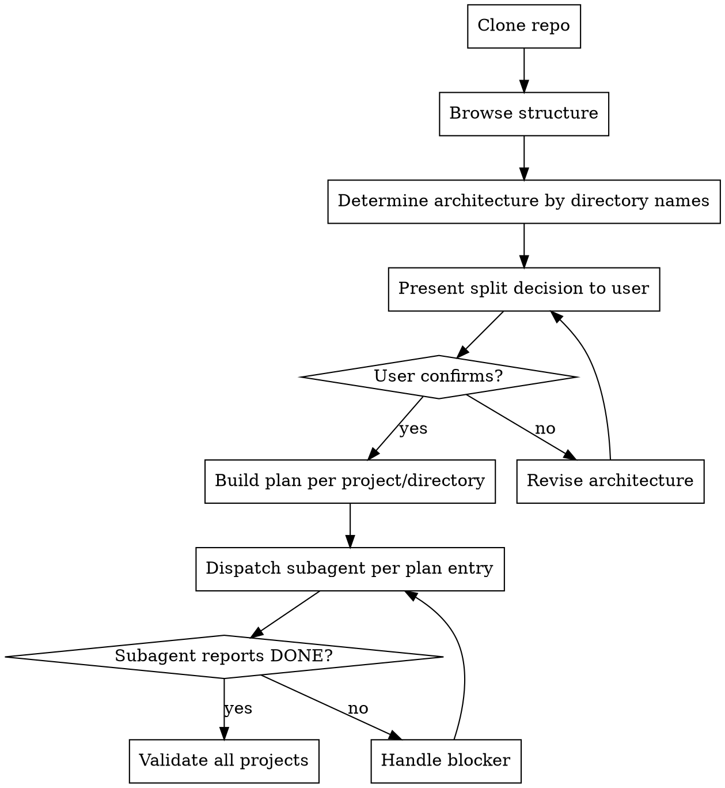

# Benchmark Project Importer

Import external security benchmark suites into irify-benchmark.

## Prerequisites

- `irify-benchmark` CLI available (`make build` or `go run ./cmd/irify-benchmark`)
- Git
- Network access to clone target repositories

## Workflow



**Text summary:**

```
Clone repo
    │
    ▼
Browse directory structure + grep for vuln markers
    │
    ▼
Determine architecture by directory names
    │
    ▼
Present multi-project vs single-project decision → user confirms
    │
    ▼
Build plan: one entry per project/directory
    │
    ▼
Dispatch subagent per plan entry
    │
    ▼
Validate all projects
```

## Step 1: Clone

```bash
git clone --depth 1 <repo-url> /tmp/<repo-name>
```

## Step 2: Browse Structure

Run reconnaissance to understand the codebase:

```bash
# Directory tree
find /tmp/<repo-name> -type d | sort

# Detect source languages
find /tmp/<repo-name> -type f | grep -E '\.(java|py|go|js|ts|cpp|c|php)$' | sed 's/.*\.//' | sort | uniq -c | sort -rn

# Source file count
find /tmp/<repo-name> -type f | grep -E '\.(java|py|go|js|ts|cpp|c|php)$' | wc -l

# Files per directory
find /tmp/<repo-name> -maxdepth 3 -type f | grep -E '\.(java|py|go|js|ts|cpp|c|php)$' | sed 's|/[^/]*$||' | sort | uniq -c | sort -rn

# Vulnerability markers (adjust pattern for the target language)
grep -r "BAD\|OK\|SAFE\|GOOD" /tmp/<repo-name>/src | head -20
```

Read a few representative files to understand the code pattern:
- Base class / interface / common module
- One simple vulnerability case
- One case with multiple markers
- README or documentation if available

## Step 3: Determine Architecture by Directory Names

**Do NOT read every file to identify sources and sinks at this stage.** Only determine the high-level organization.

Look at the directory structure and answer:

1. **How is the suite organized?**
   - By vulnerability type? (`sqli/`, `xss/`, `cmdi/`)
   - By analysis capability? (`interprocedural/`, `aliasing/`, `collections/`)
   - Flat with mixed cases? (`src/com/example/`)

2. **How many projects should we create?**
   - If organized by vuln type → likely **single project**
   - If organized by capability with mixed sinks → likely **multi-project** (split by sink type)
   - If small (< 30 files) → **single project**

3. **Which directories/files belong to which project?**
   - Map each directory to a vulnerability type or project
   - Identify shared base files that must be copied into every project

## Step 4: Present Split Decision to User

Summarize the architecture and recommend multi-project or single-project.

| Scenario | Recommendation |
|----------|---------------|
| Organized by vuln type directories | **Single project** |
| Organized by capability, sinks scattered | **Multi-project** (split by sink type) |
| Small (< 30 files) | **Single project** |

**Wait for explicit user confirmation before proceeding.**

## Step 5: Build the Plan

Create a JSON plan with one entry per project. Save it to `docs/benchmark-project-importer/<suite-name>-plan.json`.

```json
{
  "source_repo": "https://github.com/...",
  "projects": [
    {
      "id": "suite-name-vuln-type",
      "name": "Suite Name Vuln Type",
      "language": "java",
      "directories": ["securibench/micro/basic"],
      "files": ["securibench/micro/BasicTestCase.java"],
      "notes": "SQLi cases from basic package"
    }
  ]
}
```

Each entry contains:
- `id`, `name`, `language`
- `directories`: source directories that belong to this project
- `files`: specific files (including shared base classes)
- `notes`: any context for the subagent

**Do NOT include per-case source/sink details in this plan.** Those are determined by the subagent.

## Step 6: Dispatch Subagents

For each project in the plan, dispatch a subagent with:

1. The plan entry (project id, name, directories, files)
2. The cloned repo path
3. The irify-benchmark binary path
4. Instructions to:
   - Read the assigned files
   - Identify sources and sinks for each vulnerability case
   - Create the project via `project import`
   - Create all cases via `case create`
   - Run `case validate`
   - Report status (DONE / BLOCKED)

**Subagent prompt template:**

```
You are importing a subset of a benchmark suite into irify-benchmark.

## Project
- ID: {project_id}
- Name: {project_name}
- Language: {language}
- Source files to import: {directories_and_files}
- Notes: {notes}

## Steps
1. Create a temp directory and copy all assigned files + shared base files into it.
2. Run: irify-benchmark project import --id {project_id} --name "{project_name}" --language {language} --from <temp-dir>
3. Read each source file, identify source/sink locations, and create cases via `irify-benchmark case create`.
4. If a case fails validation, read the error, fix the parameters, and retry.
5. Run `irify-benchmark case validate --project {project_id}`.
6. Report: DONE with case count, or BLOCKED with reason.
```

**Dispatch all subagents in parallel** if the projects are independent.

## Step 7: Validate

After all subagents report DONE:

```bash
for proj in $(jq -r '.projects[].id' /tmp/plan.json); do
  echo "=== $proj ==="
  ./bin/irify-benchmark case validate --project "$proj"
done
```

If any subagent reports BLOCKED, assess the blocker:
- Missing shared file → copy it and re-dispatch
- Unusual source pattern → provide guidance and re-dispatch
- Structural issue with the suite itself → escalate to the user

## Reference: Architecture Decision Examples

### Example A: Organized by vulnerability type
```
src/
  ├── sqli/
  ├── xss/
  └── cmdi/
```
→ **Single project** (directories map cleanly to tags)

### Example B: Organized by analysis capability with mixed sinks
```
src/
  ├── interprocedural/   (xss, sqli mixed)
  ├── aliasing/          (xss only)
  └── collections/       (xss only)
```
→ **Multi-project** (split by sink type, because one directory contains multiple vuln types)

### Example C: Flat structure
```
src/com/example/Vuln1.java
src/com/example/Vuln2.java
```
→ **Single project** if small (< 30 files), otherwise analyze sink distribution

## CLI Reference

```bash
# Project
irify-benchmark project import --id <id> --name "..." --language java --from <path>
irify-benchmark project delete --id <id>
irify-benchmark project list

# Case
irify-benchmark case create --project <id> --id <case-id> [flags...]
irify-benchmark case validate --project <id>
irify-benchmark case delete --project <id> --case <case-id>

# Pipeline
irify-benchmark scan --project <id> --engine yaklang
irify-benchmark match --project <id> --engine yaklang --version <v>
irify-benchmark run --project <id> --engine yaklang
```
